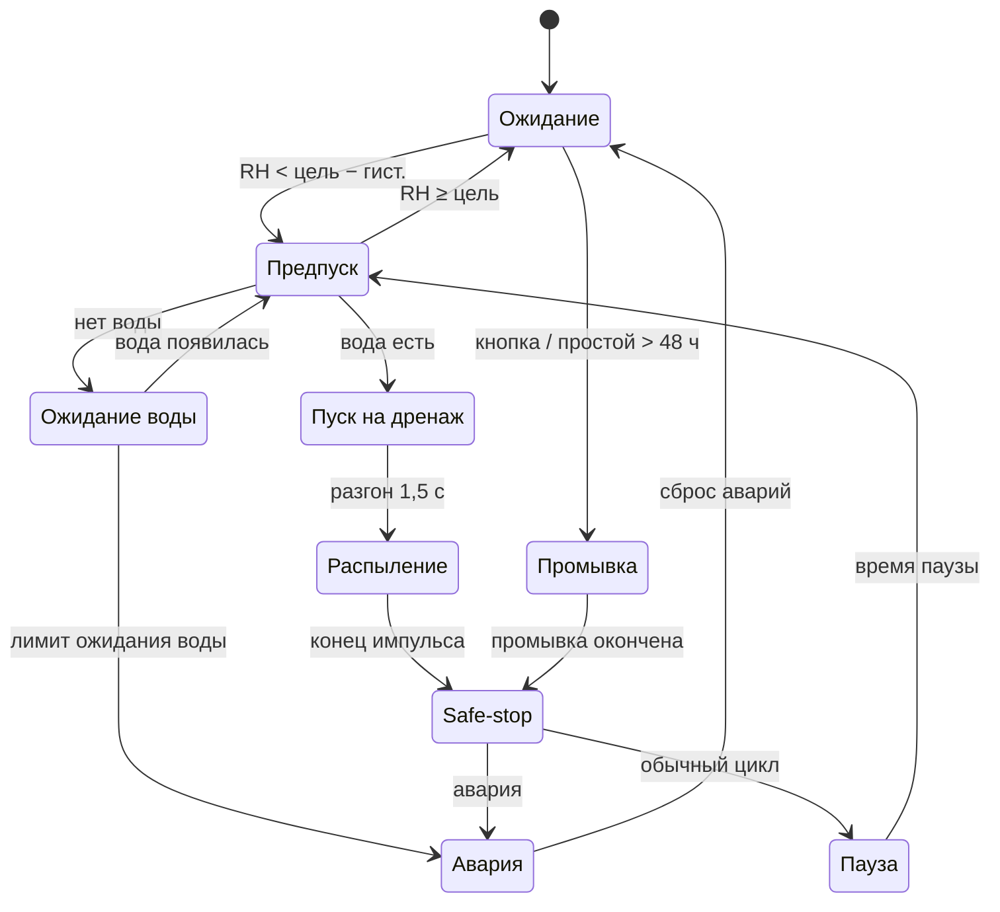

# ТЗ: система автоматического туманообразования (v2.7)

Техническое задание на домашний увлажнитель воздуха туманом высокого давления (70 бар) на ESP32-S3 + ESPHome + Home Assistant.

## Изменения

### v2.7 (30.10.2026) — проверка безопасности и отказоустойчивости

- Жёсткий предел ШИМ по умолчанию снижен с 45 до 35 %, стартовая мощность — 25 %; калибровка с 20 % шагом 2 %. По оценке 45 % на 4 форсунках 0,08 мм дают давление выше предела клапана сброса (80 бар).
- Мощность промывки ограничена тем же пределом: если клапан сброса не откроется, давление не превысит рабочее. Время промывки по умолчанию — 120 с.
- Новая жёсткая авария «Насос не остановился»: насос работает дольше «времени импульса или промывки + 30 с».
- Жёсткие аварии записываются во флэш сразу, а не раз в 15 минут: отключение питания не сбрасывает аварию.
- Исправлена ошибка: через ~25 суток непрерывной работы контроллер блокировал пуски (переполнение таймера блокировок).
- Без SNTP промывка больше не повторяется перед каждым циклом.
- Данные HA считаются недействительными сразу при потере связи с HA; у BLE-датчика свой таймаут (5 мин); значения вне 5–95 % отбрасываются.
- Перегрев фиксируется по двум показаниям подряд (сбойные 85 °C DS18B20 не дают ложную аварию).
- Выключение автоматики выводит из «Ожидания воды» — авария сухого хода не копится, пока система выключена.
- Веб-интерфейс контроллера защищён паролем (digest).
- Аппаратно: подтяжка 10 кОм к GND на GPIO7 (SSR), обязательный предохранительный клапан до первого пуска, рекомендация — реле отключения питания насоса.

### v2.6 (30.10.2026)

- Два источника влажности: BLE-термометр (pvvx) прямо на ESP32 и сенсор из Home Assistant. Выбор: «Авто» (BLE, при его отсутствии HA), «BLE» или «HA».

### v2.5 (30.10.2026)

- Датчик влажности — только сенсор из Home Assistant.
- Короткое нажатие кнопки на щитке выключает главный выключатель автоматики (а не только текущий цикл).
- Добавлен часовой пояс для времени аварий; состояние и последняя авария публикуются только при изменении.

### v2.4

- Плата: YD-ESP32-S3 N16R8 (VCC-GND Studio) вместо ESP32-S3-DevKitC-1. Светодиод статуса — встроенный WS2812 на GPIO48.
- Внешний светодиод и зуммер убраны.
- Датчики протечки вынесены в отдельную систему: вход и авария «Протечка» из контроллера убраны.
- Клапан подачи YA2 и MOSFET №2 (A3) убраны; вместо них — ночная проверка, что форсунки не капают в простое.
- Свободно 15 GPIO.

### v2.3

- ТЗ привязано к реальному оборудованию: насос FG-025 (24 V, 0,25 л/мин, 70 бар), 4 форсунки 0,08 мм, осмос 100 GPD с баком 1,5 л.
- Прямое управление насосом через MOSFET; мощность ШИМ фиксирована и калибруется по манометру.
- Пуск на открытый дренаж; сброс давления сразу после остановки насоса.
- Механический предохранительный клапан ниже 80 бар.
- Петлевая трасса: дренаж, 220 В и электроника — в техпомещении.
- «Ожидание воды» вместо мгновенной аварии сухого хода; аварии жёсткие и мягкие.
- Промывка по объёму, автопромывка после простоя; ТО по маслу, уплотнениям и фильтрам.

## 1. Назначение

Система автономно поддерживает относительную влажность в жилой комнате туманом высокого давления (70 бар) из осмосной воды. Вся логика выполняется локально на ESP32-S3 (ESPHome). Влажность контроллер берёт с BLE-термометра напрямую или из Home Assistant; HA также используется для настройки, уведомлений и телеметрии.

Насос, осмос, дренаж и электроника стоят в техническом помещении. В комнате находятся только трубка и форсунки.

## 2. Аппаратная часть

### 2.1 Контроллер и карта GPIO

YD-ESP32-S3 N16R8 (VCC-GND Studio, маркировка YD-ESP32-23). Не использовать: 0, 3, 45, 46 (strapping), 19 и 20 (USB), 26–32 (флэш), 35–37 (октальная PSRAM), 43 и 44 (UART0, лог), 47. GPIO48 занят встроенным светодиодом статуса.

| GPIO | Назначение | Тип | Примечание |
| --- | --- | --- | --- |
| 5 | ШИМ насоса (A2 XY-MOS) | выход LEDC | 10 кОм к GND |
| 7 | SSR дренажного клапана (A4) | выход | при сбросе ESP клапан закрыт |
| 15 | Реле низкого давления (SP1) | вход | норма = замкнуто |
| 18 | DS18B20 (BK1) | 1-Wire | 4,7 кОм к 3,3 V |
| 12 | Кнопка «Стоп / Сброс» (SB1) | вход | замыкает на GND |
| 48 | Встроенный RGB-светодиод WS2812 | выход RMT | на плате; если не горит — замкнуть перемычку RGB |
| 4 | Резерв: датчик давления | вход АЦП | 0,5–4,5 V через делитель 10 / 20 кОм |
| 8 / 9 | Резерв: I²C SDA / SCL | шина | SHT4x, INA226 |
| 1, 2, 6, 10, 11, 13, 14, 16, 17, 21, 38–42 | свободны | — | IO1 и IO2 — с АЦП |

Входы: внешняя подтяжка 10 кОм к 3,3 V, RC-фильтр порядка 1 кОм / 100 нФ, защита от статики на длинных линиях. Безопасность при загрузке: затвор MOSFET (GPIO5) и вход SSR-модуля (GPIO7) подтянуты к GND резисторами 10 кОм — пока ESP в сбросе, в безопасном режиме или прошивается, насос стоит и клапан закрыт; в ESPHome выходы выключаются в `on_boot` с приоритетом 800.

### 2.2 Питание

- БП 24 V DC мощностью не менее 150 Вт (насос 90 Вт плюс пусковой ток коллекторного двигателя).
- LM2596S 24 → 5 V на вывод 5V платы, ток не менее 1 А; общий GND силовой и логической части в одной точке.
- Площадку IN-OUT у вывода 5V на плате не замыкать: диод развязывает USB и внешние 5 V, поэтому прошивать по USB можно при включённом 24 V.
- Предохранители: 24 V — инерционный 6 А (рабочий ток насоса около 3,8 А, уточнить по шильдику); 220 В — 1 А на линию клапана; на вводе щитка — УЗО или дифавтомат 30 мА.

### 2.3 Насос FG-025

- 24 V DC, 0,25 л/мин, 70 бар, 3 поршня, масляная смазка, ресурс 3000 ч.
- Штатная плата управления не используется: двигатель подключён к XY-MOS напрямую. Проверить допустимый ток модуля с радиатором с учётом пускового тока.
- Диод Шоттки SR560 параллельно двигателю (катод к +), керамика 100 нФ на клеммах двигателя, ферритовое кольцо на проводах — подавление помех от щёток.
- Рабочая мощность ШИМ задаётся настройкой и калибруется по манометру (раздел 7). При 100 % давление превысит допустимое: подача насоса 0,25 л/мин против примерно 0,08 л/мин расхода 4 форсунок.
- Жёсткий предел ШИМ задаётся константой в прошивке (`pwm_max`), а не из HA: до калибровки 35 %, после — калиброванное значение плюс 10 %. Он ограничивает и рабочую мощность, и мощность промывки.
- Оценка: давление растёт примерно как квадрат подачи. 4 форсунки 0,08 мм дают около 0,08 л/мин при 70 бар, это примерно 30–33 % оборотов насоса; при 45 % давление может превысить 100 бар. Реальная зависимость от ШИМ нелинейна, поэтому точное значение — только по манометру.
- Рекомендация: реле (или второй MOSFET) последовательно в питании насоса на свободном GPIO, размыкается при любой аварии. Защищает от пробоя основного MOSFET «в короткое», когда насос работает на 100 % без управления.

### 2.4 Гидравлика

1. Осмос 100 GPD → бак 1,5 л (полезный объём около 0,7–1 л, уточнить замером).
2. Реле низкого давления SP1 (диапазон для осмоса, норма = замкнуто).
3. Фильтр-грязевик из комплекта FG-025.
4. Насос FG-025.
5. Манометр (для калибровки) и механический предохранительный клапан с открытием при 75–78 бар, слив в дренаж. **Клапан устанавливается до первого пуска насоса** — это единственная защита от превышения давления при отказе MOSFET или ошибке калибровки.
6. Трасса: трубка 1/4" из комплекта и тефлоновая 1/8"; через стену в гильзе, без соединений внутри стены.
7. 4 форсунки 0,08 мм с фильтрами: высоко, струёй в открытое пространство, не на мебель и технику.
8. Возврат трассы в техпомещение (петля).
9. Дренажный клапан JT22-02 (NC, 80 бар, проход 1 мм, 1/4 BSP, 220 В 28 ВА, 100 % ED) → канализация через гидрозатвор с разрывом струи.

Клапана подачи нет: в простое давление бака (до ~3 бар) держат обратные клапаны насоса и противокапельные клапаны форсунок. Перед вводом в работу — ночная проверка: бак полный, насос стоит, под форсунками сухо.

Расход при распылении — около 0,08 л/мин (оценка, уточняется замером). Потребность квартиры — около 0,5–1 л/ч, то есть распыление 10–20 % времени.

### 2.5 Управление клапаном сброса

- Дренаж 220 В: SSR G3MB-202P (модуль с транзисторным входом, срабатывание по высокому уровню), варистор 10D471K на клеммах катушки; ток катушки около 0,13 А.

### 2.6 Датчики

- Реле низкого давления SP1 на входе насоса: сухой контакт, норма = замкнуто, обрыв = «нет воды».
- DS18B20 на корпусе головки насоса или двигателя.
- Влажность — два источника:
    - BLE-термометр (например, LYWSD03MMC с прошивкой pvvx), принимается прямо ESP32-S3 (`ble_mac`). Работает без HA.
    - Сенсор Home Assistant (`ha_humidity`).
    - Настройка «Источник влажности»: «Авто» — BLE, а если он молчит дольше таймаута, то HA; «BLE» или «HA» — только выбранный.
    - Датчик — в комнате, вне струи тумана, в 2 м и дальше от форсунок.
- Протечка: отдельная система, к контроллеру не подключена. Автоматика HA при протечке выключает главный выключатель туманообразования.
- Опционально: датчик тока INA226 в цепи 24 V насоса для косвенного контроля давления (засор, сухой ход).

### 2.7 Индикация и корпус

- Встроенный RGB-светодиод WS2812 (GPIO48): ожидание — синий, распыление — зелёный пульс, ожидание воды — жёлтый мигающий, авария — красный мигающий, автоматика выключена — не горит.
- Светодиод находится на плате: в корпусе нужно окошко или световод.
- Звуковой сигнализации нет: аварии видны по светодиоду и в уведомлениях HA.
- Кнопка: короткое нажатие — выключение автоматики (safe-stop), удержание 3 с — сброс аварий.
- Корпус IP54, электроника выше гидравлики, кабели с петлями-каплеуловителями, сетевая часть отделена от низковольтной.

## 3. Логика работы

Контроллер — конечный автомат с одним активным состоянием. Любой выход из распыления и промывки проходит через одну процедуру safe-stop.

### 3.1 Состояния и переходы

Аварии возникают из любого состояния: сначала выполняется safe-stop, затем система переходит в «Аварию».

| Состояние | Насос | Дренаж | Светодиод |
| --- | --- | --- | --- |
| Ожидание | 0 | закрыт | синий |
| Предпуск | 0 | закрыт | синий |
| Пуск на дренаж | разгон до рабочей мощности | открыт | зелёный пульс |
| Распыление | рабочая мощность | закрыт | зелёный пульс |
| Safe-stop | 0 | открыт на время сброса | — |
| Пауза | 0 | закрыт | синий |
| Ожидание воды | 0 | закрыт | жёлтый мигающий |
| Промывка | мощность промывки | открыт | зелёный пульс |
| Авария | 0 | закрыт после сброса давления | красный мигающий |

### 3.2 Гигростат

- Серия циклов стартует при RH < Цель − Гистерезис и продолжается, пока RH < Цель. После каждой паузы Предпуск заново сравнивает RH с целью.
- Жёсткий предел: при RH ≥ Максимальная влажность (по умолчанию 60 %) распыление прерывается, новые циклы не запускаются.
- Уставка ограничена диапазоном 30–55 %.
- Используется значение выбранного источника, если оно свежее: BLE — не старше «Таймаута BLE» (по умолчанию 5 мин), HA — не старше «Таймаута данных влажности» и только пока есть связь с HA. Значения вне 5–95 % считаются неисправностью датчика. В режиме «Авто» при молчащем BLE-датчике берётся HA.

### 3.3 Импульс распыления

1. Условия пуска: главный выключатель включён, нет жёстких аварий и блокировок, не превышен лимит пусков в час, с загрузки прошло не меньше 60 с.
2. Предпусковая проверка: реле низкого давления «вода есть» стабильно 100 мс. Иначе — «Ожидание воды».
3. Открыть дренажный клапан: насос стартует без давления.
4. Плавный пуск: ШИМ линейно от 0 до «Рабочей мощности» за 1,5 с.
5. Закрыть дренажный клапан: давление поднимается до рабочего, начинается распыление.
6. Распылять «Время импульса». Если во время работы реле низкого давления разомкнуто дольше 2 с — safe-stop и «Ожидание воды».

### 3.4 Safe-stop

Единая процедура остановки: конец импульса, выключение главного выключателя, начало OTA, любая авария, кнопка на щитке.

1. ШИМ насоса = 0.
2. Через «Задержку перед сбросом» (по умолчанию 0 с) открыть дренаж на «Время сброса» (по умолчанию 3 с).
3. Закрыть дренаж.
4. Переход: Пауза (обычный цикл), Авария или состояние, из-за которого вызвана остановка.

### 3.5 Ожидание воды

- Повторная проверка каждые «Интервал повтора» (по умолчанию 5 мин).
- Вода появилась — работа продолжается без вмешательства пользователя.
- Воды нет дольше «Лимита ожидания воды» (по умолчанию 60 мин) или 3 обрыва подряд во время распыления — жёсткая авария «Сухой ход».

### 3.6 Промывка трассы (анти-легионелла)

1. Предпусковая проверка; при неудаче — «Ожидание воды», промывка откладывается.
2. Открыть дренаж, выждать 0,5 с.
3. Плавный пуск до «Мощности промывки» (не выше `pwm_max`). Через открытый дренаж с проходом 1 мм давление остаётся низким, форсунки не распыляют. Если клапан сброса не откроется, давление не превысит рабочее.
4. Промывать «Время промывки» (по умолчанию 120 с, около 0,2 л, 1–2 объёма трассы).
5. ШИМ 0, через 2 с закрыть дренаж.

Запуск: кнопка в HA или автоматически перед первым циклом после простоя дольше 48 ч (переключатель «Автопромывка»). При выключенной автопромывке пуски блокируются до ручной промывки. Простой считается по реальному времени (SNTP); метка последней работы хранится во флэш. Без SNTP промывка выполняется один раз после загрузки, дальше простой считается по времени работы контроллера.

### 3.7 Поведение при включении

1. Ранний `on_boot`: все выходы выключены.
2. Восстановить из флэш жёсткие аварии, моточасы, метку последней работы.
3. Сбросить давление: дренаж открыт на «Время сброса».
4. Не запускать циклы первые 60 с и до получения валидной влажности.

В ESPHome `api.reboot_timeout` и `wifi.reboot_timeout` = 0 s: потеря связи не перезагружает плату.

## 4. Подсистема безопасности

Жёсткие аварии фиксируются, сразу записываются во флэш (переживают отключение питания) и снимаются только кнопкой «Сброс аварий» в HA или удержанием кнопки на щитке. Мягкие блокировки снимаются сами, когда условие исчезло. Любая авария во время работы сначала вызывает safe-stop. Протечку контролирует отдельная система; контроллер получает от неё только команду выключения через HA.

| Авария | Условие | Тип | Действие сверх safe-stop |
| --- | --- | --- | --- |
| Сухой ход | воды нет дольше лимита ожидания или 3 обрыва подряд при распылении | жёсткая | красный светодиод, уведомление в HA |
| Перегрев | температура насоса выше порога (по умолчанию 70 °C) два показания подряд | жёсткая | предупреждение в логе при пороге − 10 °C |
| Неисправность датчика температуры | нет показаний DS18B20 дольше 10 с (после 30 с с загрузки) | жёсткая | — |
| Насос не остановился | насос работает непрерывно дольше max(время импульса, время промывки) + 30 с | жёсткая | страховка от зависания логики |
| Риск замерзания | температура ниже 3 °C | мягкая | запрет пусков, снятие выше 5 °C |
| Watchdog | непрерывная серия дольше лимита без достижения цели | мягкая, третья за сутки — жёсткая | пауза 30 мин |
| Нет данных влажности | нет валидных данных дольше таймаута (по умолчанию 60 мин) | мягкая | запрет пусков до появления данных |
| Залипший датчик | изменение RH меньше порога после N циклов | мягкая | пауза 60 мин |
| Максимальная влажность | RH ≥ максимума | мягкая | остановка серии |
| Требуется промывка | простой дольше 48 ч при выключенной автопромывке | блокировка | до ручной промывки |

## 5. Ресурс и ТО

Счётчики хранятся во флэш; запись — не чаще раза в 15 минут, чтобы не изнашивать флэш-память.

| Счётчик | Порог по умолчанию | Работы | Сброс |
| --- | --- | --- | --- |
| Моточасы насоса с последнего ТО | 500 ч | замена масла, осмотр уплотнений (ремкомплект FG-25-50-50s) | кнопка «Сброс ТО» |
| Фильтры форсунок | 180 дней, настраивается | замена картриджей фильтров форсунок | кнопка «Сброс фильтров» |
| Общая наработка насоса | 3000 ч (ресурс) | оценка остатка ресурса | не сбрасывается |
| Счётчик пусков | — | статистика | не сбрасывается |
| Расход воды, оценка | — | время распыления × калиброванный расход | не сбрасывается |

При каждом ТО — контроль рабочего давления по манометру и повторная калибровка мощности ШИМ (раздел 7).

## 6. Интеграция в Home Assistant

Все настройки хранятся в ESP (`restore_value: true`) и проверяются на диапазон; автоматика работает с последними сохранёнными значениями.

### 6.1 Сущности

- **Binary sensors:** Вода на входе насоса, Авария: сухой ход, Авария: перегрев, Авария: датчик температуры, Авария: насос не остановился, Риск замерзания, Watchdog, Нет данных влажности (RH), Залипший датчик RH, Ожидание воды, Требуется промывка, Требуется ТО, Требуется замена фильтров.
- **Sensors:** Температура насоса (°C), Влажность (RH) для гигростата (%), Влажность, BLE-датчик (%), Температура в комнате (°C), Батарея BLE-датчика (%), Мощность насоса (%), Моточасы всего (ч), Моточасы с последнего ТО (ч), Время простоя (ч), Пусков всего, Расход воды, оценка (л).
- **Text sensors:** Состояние, Последняя авария, Источник влажности (какой источник используется сейчас).
- **Select:** Источник влажности — Авто / BLE / HA.
- **Switches:** Главный выключатель автоматики, Автопромывка.
- **Buttons:** Сброс аварий, Запустить промывку, Сброс ТО, Сброс фильтров, Сервис: тест сброса давления (только при выключенной автоматике), Перезагрузка ESP.
- **Light:** Светодиод статуса — для проверки; в работе цвет задаёт автоматика.

Веб-интерфейс контроллера (`http://fog-controller.local`) защищён логином и паролем (`web_username`, `web_password` в secrets.yaml).

Примеры автоматизаций HA (стоп при протечке, уведомление об аварии и о потере связи) — `homeassistant/automations.yaml`.

Часть названий содержит латинские пометки (RH, s, PWM, d): ESPHome строит внутренние ID из латиницы, и русские названия одинаковой длины у него совпадают.

### 6.2 Настройки (Numbers)

| Настройка | По умолчанию | Диапазон |
| --- | --- | --- |
| Целевая влажность, % | 45 | 30–55 |
| Гистерезис, % | 3 | 1–10 |
| Максимальная влажность, % | 60 | 50–70 |
| Время импульса, с | 30 | 5–120 |
| Время паузы, с | 180 | 30–1800 |
| Максимум пусков в час | 30 | 5–60 |
| Рабочая мощность насоса, % | по калибровке (старт 25) | 15 – `pwm_max` |
| Мощность промывки (PWM), % | `pwm_max` | 15 – `pwm_max` |
| Задержка перед сбросом (s), с | 0 | 0–2 |
| Время сброса, с | 3 | 1–5 |
| Время промывки (s), с | 120 | 30–300 |
| Порог простоя для промывки, ч | 48 | 12–168 |
| Порог перегрева, °C | 70 | 50–80 |
| Лимит Watchdog, мин | 60 | 15–240 |
| Таймаут данных влажности (HA), мин | 60 | 10–180 |
| Таймаут BLE (min), мин | 5 | 2–30 |
| Циклов для проверки залипания | 10 | 3–50 |
| Порог залипания RH, % | 0,5 | 0,2–2 |
| Интервал повтора без воды, мин | 5 | 1–30 |
| Лимит ожидания воды, мин | 60 | 10–480 |
| Порог ТО, ч | 500 | 100–1000 |
| Интервал замены фильтров (d), дни | 180 | 30–365 |

Взаимное ограничение: время паузы не меньше «Задержки перед сбросом» + «Времени сброса» + 5 с.

## 7. Пусконаладка и испытания

Главное при пусконаладке — найти мощность ШИМ, при которой 4 форсунки работают на 65–70 бар, и ни разу не превысить 75 бар.

### 7.1 Калибровка

1. Убедиться, что установлен предохранительный клапан 75–78 бар.
2. Заполнить трассу промывкой: воздух выходит через дренаж.
3. Установить «Рабочую мощность» 20 % и запустить импульс; повышать шагом 2 %, пока манометр не покажет 65–70 бар. Выше 25 % давление растёт быстро.
4. Записать найденное значение; `pwm_max` в прошивке = это значение + 10 %, перекомпилировать.
5. Проверить предохранительный клапан: кратковременно поднять мощность и убедиться, что клапан открывается до 78 бар.
6. Замерить фактический расход форсунок (сбор воды за 5 минут) и вписать его в `flow_ml_min`.
7. Убедиться, что при промывке форсунки не капают; при необходимости снизить «Мощность промывки».
8. Подобрать время импульса и паузу по фактическому росту влажности: распыление 10–20 % времени.

### 7.2 Испытания защит

- [ ] Нет воды на старте: «Ожидание воды», автоповтор, авария после лимита.
- [ ] Закрыть кран осмоса во время распыления: safe-stop не позже чем через 2 с.
- [ ] Отключить DS18B20: авария неисправности датчика.
- [ ] Нагреть DS18B20 выше порога: «Перегрев».
- [ ] Режим «Авто»: вынуть батарейку из BLE-датчика — через таймаут источник переключается на HA.
- [ ] Остановить оба источника влажности: блокировка по таймауту, автоснятие при появлении данных.
- [ ] Выключить HA в режиме «Авто»: автоматика продолжает работу на BLE-датчике.
- [ ] Отключить питание во время распыления: после включения выходы выключены, давление сброшено, жёсткие аварии сохранены.
- [ ] OTA во время распыления: safe-stop до начала прошивки.
- [ ] Сбросить питание сразу после аварии: после включения авария сохранена.
- [ ] Отключить катушку клапана сброса и запустить промывку: манометр не выше рабочего давления.
- [ ] Открыть веб-интерфейс без пароля: доступ запрещён.
- [ ] Кнопка на щитке: стоп и сброс аварий.
- [ ] Светодиод показывает цвет каждого состояния из раздела 3.1.
- [ ] Протечка во внешней системе: автоматика HA выключает главный выключатель, насос останавливается через safe-stop.
- [ ] Ночь в простое с полным баком: под форсунками сухо, давление в баке не упало.

## 8. Остаточные риски и задел на будущее

Без датчика давления система не видит засор форсунок и разрыв трассы; от них защищают механика, внешняя система протечки и обслуживание.

| Риск | Последствие | Мера сейчас | Мера в будущем |
| --- | --- | --- | --- |
| Засор форсунок | давление растёт | предохранительный клапан 75–78 бар, замена фильтров по счётчику, контроль манометра при ТО | датчик давления 0–10 МПа на GPIO 4 или INA226 |
| Разрыв трубки в комнате | вода на полу | внешняя система протечки, короткие импульсы | отключение по падению давления |
| Подкапывание форсунок в простое (нет клапана подачи) | капли под форсунками | ночная проверка, противокапельные клапаны форсунок | вернуть NC-клапан подачи на свободный GPIO |
| Протечка при недоступном HA | контроллер не узнает о протечке | внешняя система перекрывает воду, насос уходит в «Ожидание воды» | релейный выход внешней системы на свободный вход |
| Дрейф давления (износ уплотнений, напряжение) | капля крупнее или мельче | повторная калибровка при каждом ТО | регулирование ШИМ по датчику давления (PI) |
| Отказ SSR в замкнутое состояние | дренаж открыт, тумана нет, вода уходит в канализацию | сработает Watchdog: влажность не растёт | контроль тока катушки |
| Пробой MOSFET насоса «в короткое» | насос работает на 100 % без управления | предохранительный клапан, внешняя система протечки, УЗО/автомат | реле отключения питания насоса на свободном GPIO |
| Реле низкого давления залипло или провод замкнут на GND | сухой ход не обнаруживается | температура насоса, Watchdog | INA226: ток насоса при сухом ходе ниже |
| Доступ к контроллеру из локальной сети | изменение настроек, сброс аварий | API с шифрованием, пароль OTA, веб-интерфейс с паролем | отдельная сеть (VLAN) для умного дома |

Задел: GPIO 4 (АЦП) и шина I²C зарезервированы. В прошивке фиксированная мощность ШИМ должна заменяться регулятором давления без изменения остальной логики.
